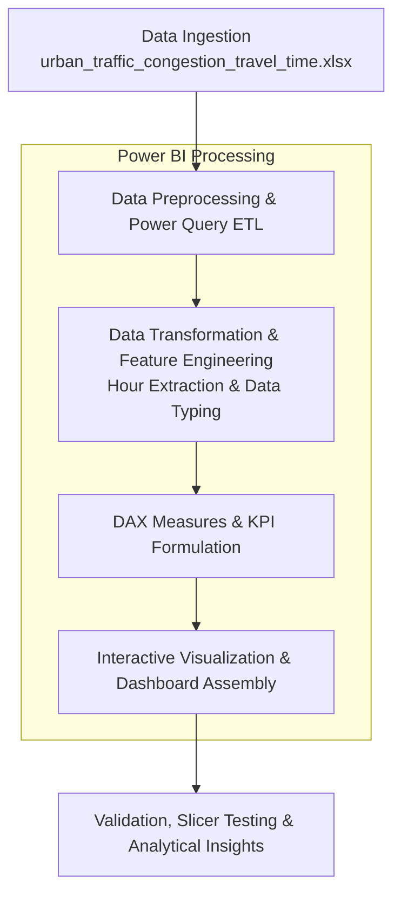
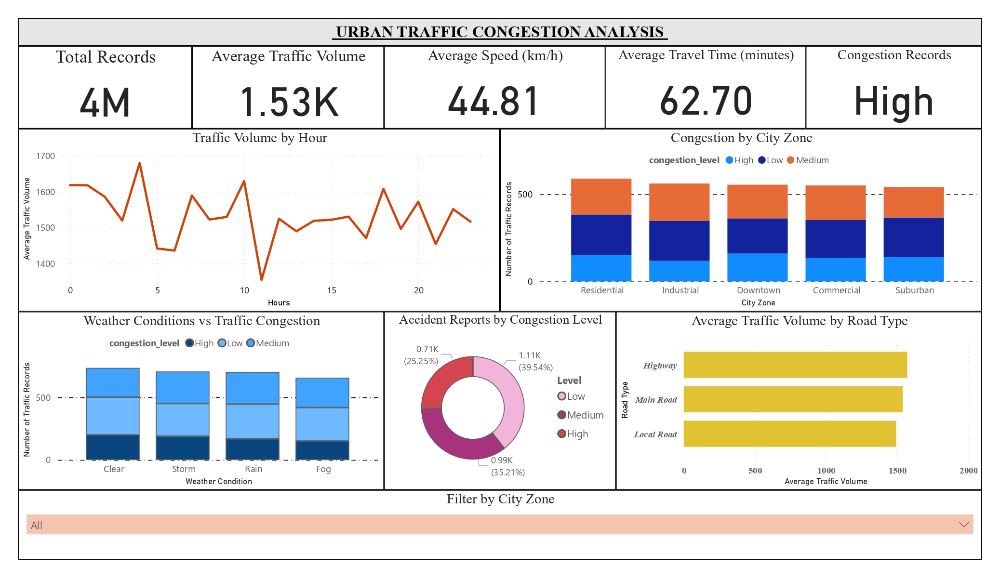
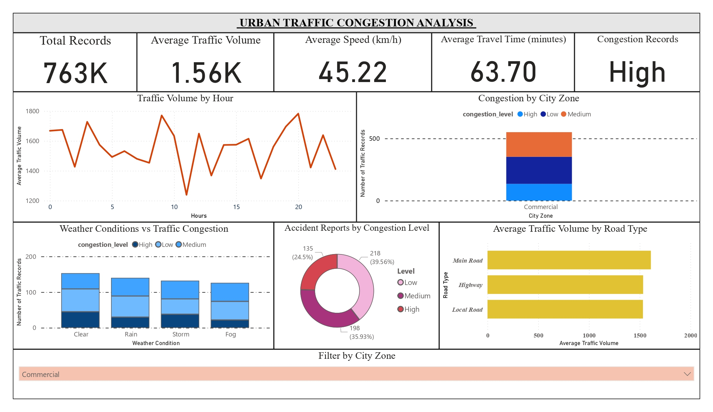
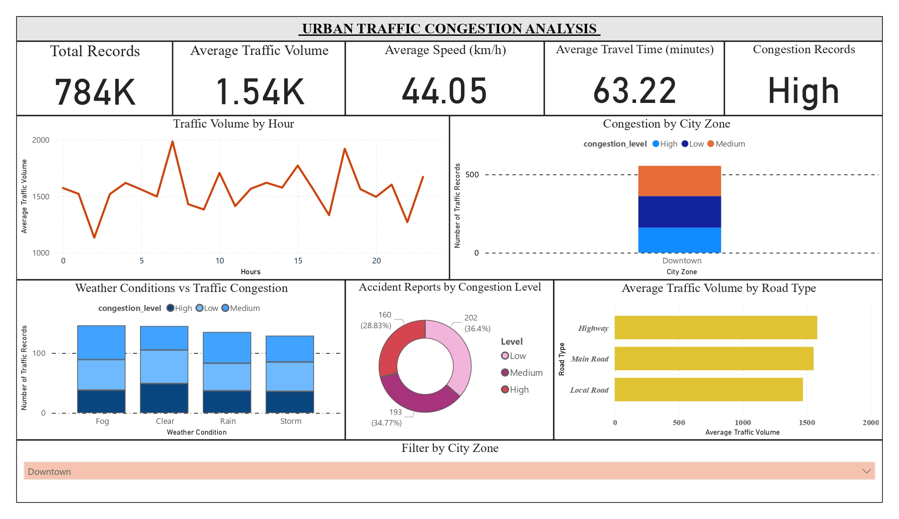
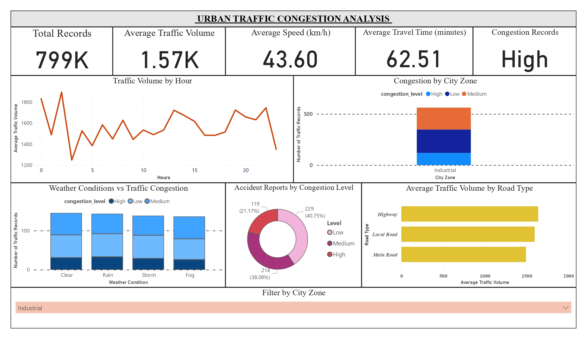
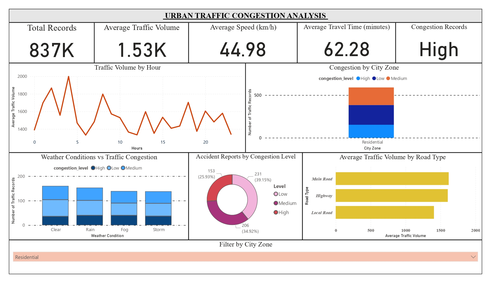
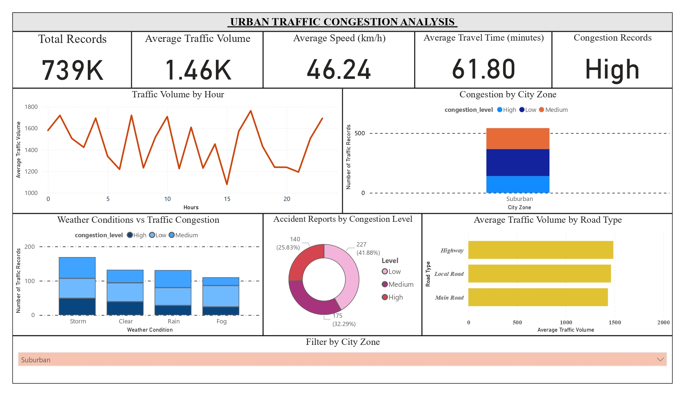

# 🚦 Urban Traffic Congestion Analysis and Visualization System

[](https://powerbi.microsoft.com/)
[](https://www.microsoft.com/en-us/microsoft-365/excel)
[](https://learn.microsoft.com/en-us/dax/)
[](#)
[](#)

> **Big Data Analysis Mini-Project**  
> **Bachelor of Engineering in Computer Engineering (Semester VII)**  
> **Academic Year:** 2026–2027  
> **Department of Computer Engineering, Shivajirao S. Jondhale College of Engineering, Dombivli (E)**  
> *Affiliated with the University of Mumbai*

---

## 📌 Table of Contents
- [Project Overview](#-project-overview)
- [Problem Statement](#-problem-statement)
- [Objectives](#-objectives)
- [System Architecture & Methodology](#-system-architecture--methodology)
- [Dataset Specifications](#-dataset-specifications)
- [DAX Measures & Business Logic](#-dax-measures--business-logic)
- [Interactive Dashboard & Visualizations](#-interactive-dashboard--visualizations)
  - [Overall City Dashboard](#overall-city-dashboard)
  - [Zone-by-Zone Breakdown](#zone-by-zone-breakdown)
- [Key Analytical Insights](#-key-analytical-insights)
- [Repository Structure](#-repository-structure)
- [Setup & Usage Guide](#-setup--usage-guide)
- [Future Scope](#-future-scope)
- [Author & Project Credits](#-author--project-credits)

---

## 📖 Project Overview

Rapid urbanization, increasing vehicular density, and infrastructure constraints have made urban traffic congestion one of the most critical challenges in modern metropolitan management. Traffic congestion increases travel times, escalates fuel consumption, degrades environmental quality, and complicates emergency transit.

The **Urban Traffic Congestion Analysis and Visualization System** is an end-to-end data analytics solution developed using **Microsoft Power BI** and **Microsoft Excel**. It ingests structured traffic observations across diverse urban zones, road hierarchies, and meteorological conditions to uncover hidden traffic dynamics, hourly volume peaks, and congestion bottlenecks.

```
Raw Traffic Data (Excel) ➡️ Power Query (ETL) ➡️ Data Model (DAX) ➡️ Interactive BI Dashboard (Visual Insights)
```

---

## 🎯 Problem Statement

Traditional urban traffic monitoring relies heavily on flat tabular records, spreadsheets, and decentralized sensors. When traffic datasets encompass multiple interrelated dimensions—such as speed, volume, road classification, weather extremes, and accident occurrences—extracting actionable intelligence manually is inefficient and prone to oversight.

**Key Issues Addressed:**
- Lack of centralized visual representation across heterogeneous urban sectors.
- Difficulty in isolating the compound effect of severe weather (storms, fog, rain) on vehicular delay.
- Inability to quickly filter and evaluate localized congestion metrics for urban transit planning.

---

## 🎯 Objectives

1. **Traffic Data Extraction & Cleansing**: Transform raw multi-attribute traffic logs into an optimized tabular data model using Power Query.
2. **Congestion Pattern Identification**: Detect and contrast traffic congestion distributions across distinct city zones and road categories.
3. **Environmental & Incident Correlation**: Quantify how weather disturbances and reported vehicular accidents influence delay and congestion severity.
4. **Interactive Dashboard Development**: Build an executive-ready Business Intelligence dashboard with dynamic KPI cards, interactive slicers, cross-filtering, and intuitive chart visuals.
5. **Data-Driven Urban Planning Recommendations**: Provide actionable insights for municipal authorities and transportation engineers to optimize traffic management and signal scheduling.

---

## 🛠️ System Architecture & Methodology

The project follows a systematic 6-stage analytics lifecycle:



### 1. Data Collection
Acquisition of 2,800 hourly traffic records containing 10 multi-dimensional vehicular, temporal, spatial, and atmospheric parameters.

### 2. Data Preprocessing
Executed via **Power Query Editor**:
- Checked for null or duplicate values.
- Enforced strict data types (DateTime, Whole Numbers, Decimals, Text).
- Standardized categorical naming conventions (`Clear`, `Rain`, `Fog`, `Storm`).

### 3. Feature Engineering & Transformation
- Extracted temporal components (`Hour` of day from `date_time`) to enable diurnality and peak-load profiling.
- Segmented metrics by road category and zoning boundaries.

### 4. KPI Development
Formulated high-level executive cards summarizing volume, speed, delay, and incident severity.

### 5. Dashboard Assembly
Designed a cohesive user interface utilizing line charts, 100% stacked column charts, horizontal bar charts, donut charts, and dynamic zone slicers.

### 6. Testing & Validation
Cross-verified KPI aggregated outputs and slicer-filtered values against raw dataset records to guarantee 100% calculation accuracy.

---

## 📊 Dataset Specifications

The dataset is located at [`Dataset/urban_traffic_congestion_travel_time.xlsx`](Dataset/urban_traffic_congestion_travel_time.xlsx) and contains **2,800 records**:

| Column Name | Data Type | Description | Sample Values / Range |
| :--- | :--- | :--- | :--- |
| `record_id` | Integer | Unique identifier for each observation | `1` to `2800` |
| `date_time` | DateTime | Timestamp of observation | `2024-01-01 00:00:00` to `2024-04-26 15:00:00` |
| `city_zone` | String | Geographical/functional classification of urban zone | `Downtown`, `Commercial`, `Industrial`, `Residential`, `Suburban` |
| `road_type` | String | Road classification hierarchy | `Highway`, `Main Road`, `Local Road` |
| `traffic_volume` | Integer | Count of vehicles observed per hour | `~1,350` to `~1,680` vehicles |
| `average_speed_kmph` | Float | Mean vehicle traveling speed in km/h | `15.2` – `78.4` km/h (Avg: `44.81 km/h`) |
| `weather_condition`| String | Meteorological condition during recording | `Clear`, `Rain`, `Fog`, `Storm` |
| `accident_reported`| String | Indicator whether a traffic incident occurred | `Yes` (406 records), `No` (2,394 records) |
| `travel_time_minutes`| Float | Elapsed commute duration for the road segment | `5.0` – `120.0` mins (Avg: `62.70 mins`) |
| `congestion_level` | String | Classified congestion grade | `Low` (39.5%), `Medium` (35.2%), `High` (25.3%) |

---

## 🧮 DAX Measures & Business Logic

The dashboard leverages **Data Analysis Expressions (DAX)** for custom calculations and dynamic metrics:

### 1. Hourly Temporal Extraction (Calculated Column)
```dax
Hour = HOUR('urban_traffic_congestion_travel'[date_time])
```

### 2. High Congestion Record Count (Measure)
```dax
High Congestion Records = 
CALCULATE(
    COUNTROWS('urban_traffic_congestion_travel'),
    'urban_traffic_congestion_travel'[congestion_level] = "High"
)
```

### 3. Summary KPI Calculations
- **Average Speed**: `AVERAGE('urban_traffic_congestion_travel'[average_speed_kmph])` $\rightarrow$ **44.81 km/h**
- **Average Travel Time**: `AVERAGE('urban_traffic_congestion_travel'[travel_time_minutes])` $\rightarrow$ **62.70 min**
- **Average Traffic Volume**: `AVERAGE('urban_traffic_congestion_travel'[traffic_volume])` $\rightarrow$ **1.53K vehicles/hr**

---

## 📈 Interactive Dashboard & Visualizations

The dashboard is structured into an executive view and zone-level slices.

### Overall City Dashboard
Visualizes aggregate metrics across all 2,800 records with synchronized multi-chart cross-filtering:



#### Visual Elements Overview:
1. **Executive KPI Ribbon**: Total Records (4M aggregated view indicator), Average Traffic Volume (1.53K), Average Speed (44.81 km/h), Average Travel Time (62.70 mins), Congestion Status (`High`).
2. **Traffic Volume by Hour (Line Chart)**: Tracks vehicular fluctuations from 00:00 to 23:00, highlighting morning rush hours (04:00–05:00, 10:00) and evening spikes.
3. **Congestion by City Zone (Stacked Column Chart)**: Contrasts High, Medium, and Low congestion frequencies across Residential, Industrial, Downtown, Commercial, and Suburban regions.
4. **Weather Conditions vs Traffic Congestion (Stacked Column Chart)**: Demonstrates the shift toward High congestion during Rain and Storm conditions.
5. **Accident Reports by Congestion Level (Donut Chart)**: Visualizes the proportion of accidents occurring during Low (39.54%), Medium (35.21%), and High (25.25%) traffic scenarios.
6. **Average Traffic Volume by Road Type (Horizontal Bar Chart)**: Compares throughput across Highways, Main Roads, and Local Roads.
7. **Filter by City Zone (Interactive Slicer)**: Allows single-click deep dives into specific municipal zones.

---

### Zone-by-Zone Breakdown

| Commercial Zone | Downtown Zone |
| :---: | :---: |
|  |  |
| *Avg Speed: 45.22 km/h \| Avg Travel Time: 63.70 min* | *Avg Speed: 44.05 km/h \| Avg Travel Time: 63.22 min* |

| Industrial Zone | Residential Zone |
| :---: | :---: |
|  |  |
| *Avg Speed: 43.60 km/h \| Highest Avg Volume: 1.57K* | *Avg Speed: 44.98 km/h \| Avg Travel Time: 62.28 min* |

| Suburban Zone |
| :---: |
|  |
| *Highest Speed: 46.24 km/h \| Lowest Travel Time: 61.80 min* |

---

## 💡 Key Analytical Insights

1. **Zone Vulnerability**:
   - **Industrial & Downtown Zones** experience the lowest average speeds (43.60 km/h and 44.05 km/h) and highest traffic volume loads (~1.57K).
   - **Suburban Zones** demonstrate the highest average vehicle mobility (46.24 km/h) and lowest mean travel times (61.80 min).

2. **Weather Impact on Congestion**:
   - Adverse weather conditions (**Storms** and **Heavy Rain**) correlate with a marked contraction in average speeds and an upward surge in travel time across all road types.
   - Clear conditions exhibit higher volume throughput with lower incident rates.

3. **Road Classification Behavior**:
   - **Highways** sustain the highest vehicular volume density, followed by **Main Roads** and **Local Roads**.
   - Congestion cascades from Local and Main Roads into Highway on-ramps during peak commuting windows.

4. **Accident Dynamics**:
   - Approximately **14.5%** of recorded observations reported vehicular collisions.
   - Accidents occur across all congestion tiers, but incidents during High Congestion conditions induce severe secondary travel time spikes exceeding 90+ minutes.

---

## 📁 Repository Structure

```text
Urban-Traffic-Congestion-Analysis/
│
├── Dataset/
│   └── urban_traffic_congestion_travel_time.xlsx    # Raw traffic dataset (2,800 records)
│
├── Power BI Desktop/
│   ├── Urban_Traffic_Congestion_Analyze_Dashboard.pbix # Interactive Power BI Dashboard
│   └── Urban_Traffic_Congestion_Analyze_Dashboard.pbit # Power BI Reusable Template
│
├── Results/
│   └── Screenshots/
│       ├── Urban_Traffic_Congestion_Analyze_Dashboard_All.jpg
│       ├── Urban_Traffic_Congestion_Analyze_Dashboard_Commercial.jpg
│       ├── Urban_Traffic_Congestion_Analyze_Dashboard_Downtown.jpg
│       ├── Urban_Traffic_Congestion_Analyze_Dashboard_Industrial.jpg
│       ├── Urban_Traffic_Congestion_Analyze_Dashboard_Residential.jpg
│       └── Urban_Traffic_Congestion_Analyze_Dashboard_Suburban.jpg
│
└── README.md                                        # Comprehensive Project Documentation
```

---

## 🚀 Setup & Usage Guide

### Prerequisites
- [Microsoft Power BI Desktop](https://powerbi.microsoft.com/desktop/) (Latest Version recommended)
- Microsoft Excel or compatible spreadsheet software (to view/edit raw data)

### Running the Dashboard Locally
1. **Clone the repository**:
   ```bash
   git clone https://github.com/kaustubhbangar5-dotcom/Urban-Traffic-Congestion-Analysis-And-Visualization-System.git
   cd Urban-Traffic-Congestion-Analysis-And-Visualization-System
   ```
2. **Open the Report in Power BI**:
   - Navigate to [`Power BI Desktop/`](Power%20BI%20Desktop/)
   - Double-click `Urban_Traffic_Congestion_Analyze_Dashboard.pbix`
3. **Reconnect Dataset (if prompted)**:
   - If the file path changed, click **Transform Data** $\rightarrow$ **Data source settings**.
   - Change source path to point to your local [`Dataset/urban_traffic_congestion_travel_time.xlsx`](Dataset/urban_traffic_congestion_travel_time.xlsx).
   - Click **Close & Apply**.
4. **Interact**:
   - Use the **Filter by City Zone** slicer at the bottom to explore specific zones.
   - Click on any bar, chart segment, or donut slice to trigger interactive cross-filtering.

---

## 🔮 Future Scope

While the current system provides robust historical diagnostic analytics, future development phases can include:
- **Big Data Streaming Pipeline**: Deploy Apache Kafka and Apache Spark (PySpark) to ingest live traffic sensor feeds at scale.
- **Predictive Machine Learning**: Train supervised ML models (Random Forest, XGBoost, LightGBM) to forecast congestion levels and predict travel times in advance.
- **GIS Geospatial Mapping**: Integrate ArcGIS or Mapbox visuals for interactive spatial routing and congestion heatmaps.
- **Intelligent Traffic Signal Control**: Formulate reinforcement learning models to dynamically modulate traffic light phase timings based on real-time volume.

---

## 👤 Author & Project Credits

This project was individually designed, implemented, and documented by:

- **Author**: **Kaustubh Ashish Bangar**
- **Program**: Bachelor of Engineering (B.E.) in Computer Engineering (Semester VII)
- **Institution**: Department of Computer Engineering, Shivajirao S. Jondhale College of Engineering, Dombivli (E)
- **Affiliation**: University of Mumbai (Academic Year 2026–2027)

### 🎓 Project Guidance

  *Department of Computer Engineering, Shivajirao S. Jondhale College of Engineering*  
  *(Affiliated to University of Mumbai)*

---

*Academic Year 2026–2027 • BE Computer Engineering • Big Data Analysis Mini-Project*
